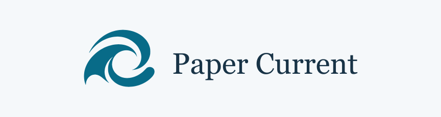

# Paper Current

海洋微生物・微生物ゲノミクスの新着論文を、日本語・英語で読むサイトです。

**[Paper Currentを開く →](https://stsnsn.github.io/paper-current/)**

<picture>
  <source media="(prefers-color-scheme: dark)" srcset="docs/assets/readme-dark.svg">
  <source media="(prefers-color-scheme: light)" srcset="docs/assets/readme-light.svg">
  
</picture>

雑誌論文の掲載誌を予想する4択クイズや新着論文一覧を用意しています。検索や「あとで読む」保存も利用できます。

収集・翻訳・公開の手順、実装仕様、テストについては[開発・運用ガイド](docs/development.md)を参照してください。
